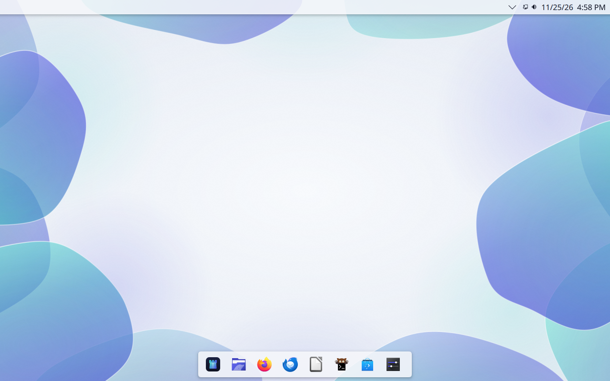

  <picture>
    <source media="(prefers-color-scheme: dark)" srcset="components/glassfort-branding/glassfort-lockup-horizontal-dark.svg">
    
  </picture>

<em>Beautiful as glass. Strong as a fortress.</em>

  
  
  
  

Glassfort is an Arch-based Linux distribution with Windows-style usability, a
macOS-inspired glass design, security by default and bootable snapshots that
make it practically unbreakable. Windows apps can run seamlessly through an
optional VM.

## Status

**Phase 1 (foundation on plain Arch) is complete** – but Glassfort is not
ready for users yet: there is no public package repository and no
installer image. Phase 2 brings the own ISO, Restore Points, the update app
and Secure Boot ([roadmap](docs/09-roadmap.md)).

What works today, tested end to end in a VM (`tests/vm/phase1`): on a plain
Arch install with Btrfs and Limine, `pacman -S glassfort-desktop` turns the
system into Glassfort, and a broken update can be rolled back from the boot
menu.

## What is in it

| | |
|---|---|
| **Unbreakable** | Btrfs with snapper; every update takes a snapshot, and snapshots boot straight from the Limine menu (limine-snapper-sync). Restore puts the system back. |
| **Secure by default** | AppArmor, firewalld with a Glassfort zone, hardened sysctl defaults, zram. |
| **Glass design** | Own colour schemes, Kvantum and GTK themes generated from one palette, light/dark switching by time of day, Inter and JetBrains Mono, wallpaper, boot splash, login and lock screen. |
| **Windows-style shell** | Own Plasma widgets: start menu (search, pinned apps, recent files), dock (pinned and running apps, live previews, jump lists), control center (Wi-Fi, Bluetooth, volume, brightness, night light, dark mode, Do Not Disturb, screen recording). |
| **Curated Plasma** | KDE Plasma 6 with a curated set of apps: Firefox, Thunderbird, LibreOffice, Dolphin, kitty and more. |

Planned: Restore Points and update app (Phase 2), an AI assistant that can only
use typed, validated tools (Phase 3), own installer and first boot
(Phase 4), Windows apps in a VM (Phase 5).

## Repository

| Path | Content |
|---|---|
| [`components/`](components/) | One folder per package (PKGBUILD, sources, README) |
| [`docs/`](docs/) | Specification: [overview](docs/00-overview.md), [architecture](docs/01-architecture.md), [system](docs/02-system.md), [desktop & design](docs/03-desktop-design.md), [testing](docs/07-testing.md), [roadmap](docs/09-roadmap.md), [decisions](docs/DECISIONS.md) |
| [`repo/`](repo/) | Signing and publishing the `[glassfort]` package repository |
| [`scripts/`](scripts/) | CI and developer tools (headless screenshots of widgets and whole sessions, qmllint, link check) |
| [`tests/vm/`](tests/vm/) | Automated Phase 1 VM test (QEMU/KVM, OVMF) |

For contributors: [`CONTRIBUTING.md`](CONTRIBUTING.md),
[`SECURITY.md`](SECURITY.md), [`CODE_OF_CONDUCT.md`](CODE_OF_CONDUCT.md).

Glassfort is based on Arch Linux but is not affiliated with or endorsed by the
Arch Linux project. Please do not ask for Glassfort support in Arch Linux
channels.

## Help and feedback

Questions and ideas go to [Discussions](https://github.com/glassfortos/GlassfortOS/discussions),
bugs to [Issues](https://github.com/glassfortos/GlassfortOS/issues/new/choose),
security problems privately (see [`SECURITY.md`](SECURITY.md)). More in
[`CONTRIBUTING.md`](CONTRIBUTING.md).

## Licence

Code: GPL-3.0-or-later ([`LICENSE`](LICENSE)). Documentation and artwork:
CC BY-SA 4.0 ([`LICENSES/CC-BY-SA-4.0.txt`](LICENSES/CC-BY-SA-4.0.txt)). The
Glassfort name and logo are not covered by these licences (see
[`TRADEMARKS.md`](TRADEMARKS.md)).
